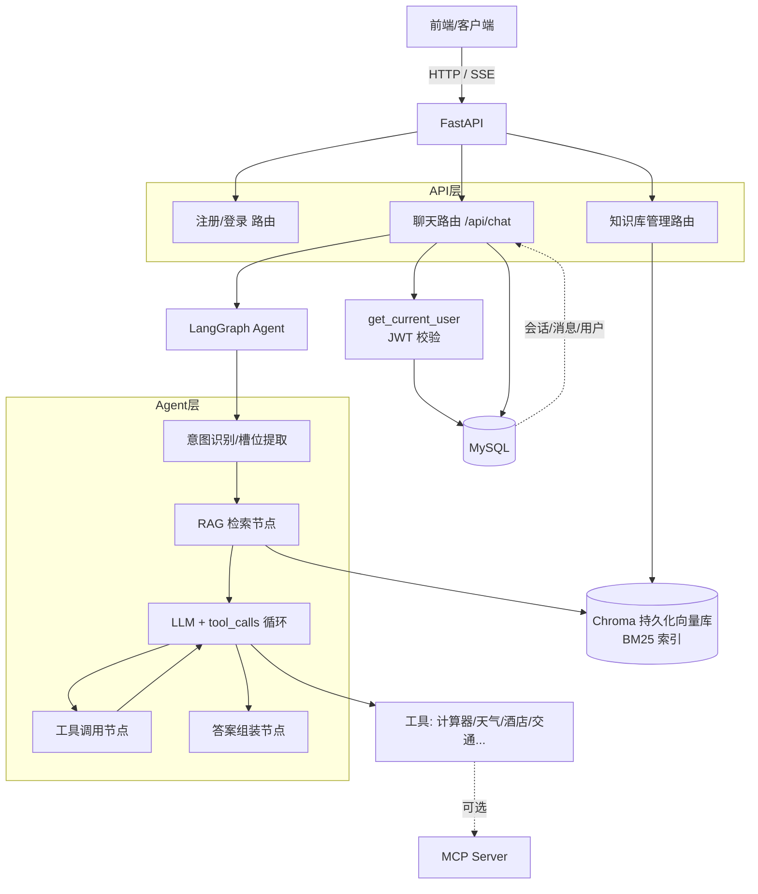

# 练手 Agent 项目 · 待办清单与开发路线

> 诊断时间：2026-09-26
> 项目现状一句话：**Agent（LangGraph + RAG）只能在命令行用 `input()` 跑；FastAPI 里的聊天接口全是 `pass`；两边没有打通，且多个文件当前直接报错、无法启动。**

---

## 一、现状盘点

### 1. 项目里实际有三套东西混在一起
| 位置 | 内容 | 状态 |
| --- | --- | --- |
| 根目录（agent.py / graph.py / rag.py / tool.py / ft.py） | **旅游 Agent + FastAPI 草稿**（项目主体） | Agent 能命令行跑，后端是空壳 |
| `fastap/` | **养老项目**（elder / health，从另一个项目拷来的） | 结构规整但有多处 bug，且与旅游 Agent 无关 |
| book.py / ft2.py / test.py / yufa.py / jiexi.py / brute.html | FastAPI、asyncio、二叉树、CTF 的零散练习 | 与项目无关 |

**第一个要做的决定**：这个仓库的主线是「旅游 Agent + 后端」，建议把 `fastap/` 移回养老项目仓库，练习文件归档到 `scratch/` 或删除，避免越改越乱。

### 2. 当前直接导致跑不起来的错误（P0 修复清单）
- [ ] `state.py` 第 19 行 `def __init__(session:dict[str],messages,)` 没有函数体，**语法错误**；TypedDict 不需要写 `__init__`，直接删掉
- [ ] `graph.py` 底部（127–163 行）有 `input()`、`display(Image(...))` 和测试逻辑，**该文件一被 import 就会卡住等输入**。要把测试代码挪到 `if __name__ == "__main__":` 或单独的 `run_local.py`
- [ ] 硬编码环境文件路径 `find_dotenv(r"D:\agent_test\test.env")`（agent.py、graph.py、session/memory.py 共 3 处），换电脑即失效。统一改成项目根目录 `.env` + `load_dotenv()`
- [ ] `session/memory.py`：`os.getenv["api_key"]` 写法错误（getenv 是函数，要用圆括号，且 key 名应为 `OPENAI_API_KEY`）
- [ ] `fastap/schemas/health.py` 是空文件，但 `routers/health.py` 要 import `HealthRecord_create` → **ImportError**
- [ ] `fastap/models/users.py` 是空文件，但 `core/settings.py` 要 import `User_table` → **ImportError**
- [ ] `ft.py` 路由里用了未定义的 `Hero` 类（SQLModel 官方示例残留）
- [ ] `ft.py` 第 23 行 `mysql_url=f"mysql://{mysql_file_name}"` 写法错误，SQLite 应该是 `sqlite:///database.db`
- [ ] `ft.py` 同时混用了 SQLModel+SQLite 和 async SQLAlchemy+MySQL 两套数据库，二选一
- [ ] `fastap/core/settings.py` 文件名与内容不符（里面是 auth 草稿，不是配置）；且 `jwt.encode(..., algorithm=[ALGORITHM])` 应为 `algorithm=ALGORITHM`
- [ ] `fastap` 里所有 `Depends(get_db())` 都多了括号，应为 `Depends(get_db)`
- [ ] `rag.py` 的 `split_into_chunks(doc_file)` 忽略了传入参数，内部硬编码了 information.md 路径

---

## 二、P0 · 先跑起来（预计 1 天）

- [ ] **确定目录结构**，建议改成：
  ```
  练手agent/
  ├── app/
  │   ├── main.py            # FastAPI 入口
  │   ├── api/               # 路由（chat / auth / knowledge）
  │   ├── agent/             # graph.py / agent.py / state.py / prompts.py
  │   ├── tools/             # tool.py
  │   ├── rag/               # rag.py + 向量库持久化目录
  │   ├── core/              # config / security / 统一响应
  │   └── db/                # engine、models、会话表
  ├── .env / .env.example
  ├── requirements.txt
  └── README.md
  ```
- [ ] 根目录建 `.env`：`OPENAI_API_KEY`、`OPENAI_BASE_URL`、`WEATHER_API_KEY`、`SECRET_KEY`、数据库连接串
- [ ] 修复上面「现状 2」列出的全部报错
- [ ] `graph.py` 只保留 `make_graph()` 和编译好的 graph，**模块级别不执行任何请求**
- [ ] 能在一个干净的 Python 文件里 `from graph import graph; graph.invoke(...)` 成功

---

## 三、P1 · 核心链路：把 Agent 接进 FastAPI（项目最关键的一步）

### 1. 聊天接口（目前 `ft.py` 的 `/api/chat/to_agent` 只有 `pass`）
- [ ] `POST /api/chat`：入参 `{session_id, message, history?}`
- [ ] 内部把用户消息包成 `HumanMessage`，调用 `await graph.ainvoke(state, config)`
- [ ] `config = {"configurable": {"thread_id": session_id}}`，**thread_id 不能写死成 "1"**（现在 session/memory.py 里写死了）
- [ ] 返回 AI 回复 + 本轮调用了哪些工具
- [ ] **流式输出（强烈建议做，聊天体验的核心）**：
  - `GET /api/chat/stream`，用 `StreamingResponse` + SSE
  - 或 WebSocket `/api/chat/ws`
  - 内部用 `graph.astream_events()` / `astream()`，把 token、工具调用状态实时推给前端

### 2. 用户注册 / 登录 / JWT（你最近一直在学的部分）
- [ ] `models/user.py`：用户 ORM 表，字段 `id / username / hashed_password / email / full_name / disabled / create_time`
- [ ] `POST /api/auth/register`：bcrypt hash 后入库，**不返回 token**
- [ ] `POST /api/auth/token`：用 `OAuth2PasswordRequestForm` 接表单，查库 + `pwd_context.verify(明文, 哈希)`，通过后 `jwt.encode` 分发 token
- [ ] `core/security.py` 写好 4 件套：`get_password_hash / verify_password / create_access_token / get_current_user`
- [ ] `get_current_user` 内部：`jwt.decode` 校验签名+过期 → 取 `sub` → **再查一次库确认用户没被禁用**
- [ ] 所有业务路由加 `current_user = Depends(get_current_user)`；注册、登录路由不加
- [ ] 注意修正：用 `datetime.utcnow()` 而不是 `datetime.now()`；`jwt.decode` 的 `algorithms` 必须是列表 `[ALGORITHM]`

### 3. 会话与历史消息持久化
- [ ] 现在用的 `InMemorySaver` **一重启记忆全丢**，只能用于本地调试
- [ ] 数据库建两张表：
      `conversation`（id、user_id、title、create_time）
      `message`（id、conversation_id、role、content、tool_calls、create_time）
- [ ] 方案 A：用 LangGraph 官方持久化 checkpointer（如 SqliteSaver / 社区 MySQL checkpointer）
- [ ] 方案 B：自己在聊天接口里把每轮 Human/AI/Tool 消息落库
- [ ] `GET /api/conversations`：当前用户的会话列表
- [ ] `GET /api/conversations/{id}/messages`：恢复某次会话的历史消息（ft.py 里已有空路由）
- [ ] 新建会话 / 重命名 / 删除会话接口

### 4. RAG 改造（现在的写法每次请求都在重新加载模型，非常慢）
- [ ] **知识库只构建一次，持久化保存**：Chroma 从 `EphemeralClient()`（内存级，用完就没）改成 `PersistentClient(path="./rag/chroma_db")`
- [ ] embedding 模型（text2vec-base-chinese）和 CrossEncoder 在应用启动时（lifespan）加载一次，全局复用
- [ ] 切分、BM25 索引、向量入库做成**离线预构建脚本** `build_index.py`，不要放在 graph 的 rag 节点里
- [ ] rag 节点运行时只做：query 向量化 → BM25 召回 + 向量召回 → RRF 融合 → rerank
- [ ] 切块从简单的 `split("\n\n")` 升级为带 overlap 的固定长度切块（如 LangChain RecursiveCharacterTextSplitter，chunk_size=500，overlap=80）
- [ ] 给向量库的文档加 metadata（景点名、品类），支持元数据过滤

### 5. 知识库管理接口（ft.py 里 `/api/knowledge` 是空的）
- [ ] `POST /api/knowledge/upload`：上传 txt / md / pdf / docx
- [ ] 文件解析 → 清洗 → 切块 → 向量化 → 写入持久化 Chroma
- [ ] `GET /api/knowledge`：知识库文档列表
- [ ] `DELETE /api/knowledge/{id}`：删除文档并同步删除向量

---

## 四、P2 · Agent 能力补全

- [ ] **MCP 真正接进 Agent**：`mcpuses/` 现在只是独立 demo（server + client 各跑各的）。用 `langchain_mcp_adapters` 的 `MultiServerMCPClient` 连上 MCP server，`get_tools()` 拿到工具后合并进 `tools` 列表，再编译 graph
- [ ] **输出闭环**：state 里定义了 `output_schema.total_output`，但没有任何节点产出它。最后要加一个节点，把检索资料 + 工具结果组装成用户看到的完整行程方案
- [ ] **规划解析（parser）只做一次**：现在 graph 外手动跑 parser、graph 里 rag 节点又跑一次 parser，职责混乱。明确成：意图识别/槽位提取节点 → RAG 节点 → 工具节点 → 组装节点
- [ ] 槽位补全：人数、日期、预算等信息缺失时，让 Agent 一次性追问，而不是直接开编
- [ ] 长期记忆：用 LangGraph `Store` 记住用户偏好（常住地、预算档位、出行风格、历史目的地）
- [ ] 短期记忆：把 `session/memory.py` 的 `short_memory` 接成中间件/节点（现有代码有 bug：dict 索引 `human_ai_pair[count]` 越界、`model.invoke(content=...)` 参数写法错误）
- [ ] 中间件落地（middleware.py 现在全是半成品）：
      - 消息裁剪（已有 `trim_messages` 雏形，接进 create_agent 的 middleware）
      - `wrap_tool_call` 隐私检查（session/privacy.py 是空的）：工具返回的手机号/身份证脱敏
      - `HumanInTheLoopMiddleware`：高风险操作（如下单、删除）人工确认
- [ ] 旅游场景工具补充：酒店搜索、机票/火车票、门票预约、地图路线、多日天气预报（现在天气工具只查当天）
- [ ] 现在的 `router()` 函数（graph.py 30–36 行）用 `"天气" in query` 硬编码路由，且没接进图里，建议删除，让 LLM 自己通过 tool_calls 决策

---

## 五、P3 · 工程化、安全与部署

### 工程基础
- [ ] `requirements.txt`（或 pyproject.toml）锁定依赖：fastapi、uvicorn、sqlalchemy、pymysql、langchain、langgraph、langchain-mcp-adapters、python-jose/pyjwt、passlib[bcrypt]、chromadb、sentence-transformers、jieba、fastmcp、python-dotenv
- [ ] `.gitignore`：`.env`、`__pycache__/`、`*.db`、`logs/`、`chroma_db/`、`.venv/`
- [ ] `.env.example`：只放 key 名不放值
- [ ] `README.md`：项目简介、目录结构、启动步骤、接口列表、测试账号
- [ ] **Alembic 数据库迁移**：不要再靠 `create_all` 建表，表结构变更无法管理
- [ ] `pytest` 测试：工具单测、RAG 召回测试、接口测试（登录 → 聊天 → 历史）
- [ ] Dockerfile + docker-compose（API + MySQL 一起起）

### 安全（你已经在 brute.html / password.txt 里接触过攻防，正好用上）
- [ ] **删除所有硬编码密钥**：ft.py 第 160 行数据库密码明文、core/settings.py 的 `SECRET_KEY="ask102938asdlifuj"` 弱密钥、mysql.env 里的真实密码
- [ ] SECRET_KEY 用 `openssl rand -hex 32` 生成长随机串，放 .env
- [ ] CORS 中间件：明确允许的前端域名，不要 `allow_origins=["*"]`
- [ ] **登录限流**：同 IP / 账号连续失败 N 次锁定或加验证码（slowapi），防止 password.txt 那种爆破
- [ ] 密码强度校验（长度 + 复杂度）
- [ ] JWT 过期时间合理（access token 30 分钟，可加 refresh token）
- [ ] 敏感字段（手机号、身份证）入库加密 / 输出脱敏

### 可观测性
- [ ] 全局异常处理器（统一返回 ApiResponse，不要把堆栈抛给前端）
- [ ] 请求 ID 中间件，日志按请求串联（logging_helper.py 已有的日志可以继续用）
- [ ] 接入 LangSmith 或 Langfuse：追踪每次 LLM 调用、token 消耗、检索命中、延迟
- [ ] 接口耗时 / 限流 / 错误率指标

---

## 六、目标架构



---

## 七、推荐开发顺序（照着做即可）

1. **第 1 步**：整理目录、修好所有报错、`.env` 统一配置，让 graph 能被 import 调用
2. **第 2 步**：写 `POST /api/chat`，在接口里 `await graph.ainvoke()`，**先把后端和 Agent 打通**（哪怕先不鉴权、记忆只在内存）
3. **第 3 步**：用户表 + 注册 + 登录发 JWT + get_current_user，给聊天接口加鉴权
4. **第 4 步**：会话表 + 消息表 + 持久化 checkpointer + 历史查询接口
5. **第 5 步**：RAG 预构建 + Chroma 持久化，消灭每请求重载模型的问题
6. **第 6 步**：SSE 流式输出
7. **第 7 步**：MCP 工具接入、长期记忆、知识库上传
8. **第 8 步**：requirements / README / .gitignore / Alembic / 测试 / Docker / 限流监控

> 核心原则：**先打通一条完整链路（发消息 → Agent 跑 → 拿到回复），再逐层加鉴权、持久化、流式和工程化**，不要在每条链路都没通的时候同时铺开所有模块。

---

## 八、2026-09-30 复核 + 企业级改造清单（追加）

> 复核方式：逐文件核对代码，结论与「一」对照。
> 结论一句话：**自 09-26 诊断以来 P0 一个都没修，项目当前无法 import / 启动**。企业级是终点，当前在第 0 步。

### 0. 复核确认（仍然存在）
- state.py 第 19 行 def __init__(session:dict[str],messages,) 语法错误 —— 仍在
- graph.py 底部模块级 input("请输入你的问题") + display(Image(...)) —— 仍在
- agent.py / graph.py / session/memory.py 三处硬编码 ind_dotenv(r"D:\agent_test\test.env") —— 仍在
- session/memory.py：os.getenv["api_key"]、	hread_id="1"、model.invoke(content=...) —— 仍在
- session/privacy.py 71 字节空壳 —— 仍在
- 根目录无 app/、.env、requirements.txt、.gitignore、README、Dockerfile，无 git 仓库
- FastAPI 主体在 fastap/（养老项目），与旅游 Agent 未打通；根 ft.py 全被注释

### 1. 企业级清单里原版漏掉的 4 项（必须补，否则不算企业级）
| 缺口 | 说明 |
| --- | --- |
| Agent 评测（Evals） | 黄金问题集回归、检索命中率、工具调用成功率；没有评测，改版即退化不可见 |
| Prompt 注入防护 | 对外部文档/工具返回做隔离与校验，防止指令注入 |
| 多租户 + RBAC | 用户级数据隔离、角色权限，不只是"能登录" |
| 成本/令牌治理 | 每会话 token 预算、超长裁剪、模型分级（贵/便宜模型分流） |

### 2. 推荐执行顺序（照做）
1. 阶段 0：修 P0 + 建目录/.env/requirements → 让 rom graph import graph 能成功
2. 阶段 1：POST /api/chat 打通后端与 Agent（先不鉴权、内存记忆）
3. 阶段 2：用户表 + JWT + 会话/消息落库
4. 阶段 3：RAG 预构建 + Chroma 持久化
5. 阶段 4：SSE 流式 + MCP + 长期记忆 + 中间件
6. 阶段 5：Alembic/测试/Docker + 安全加固 + 可观测 + 评测

> 原则：先打通一条完整链路（发消息→Agent→回复），再逐层加鉴权、持久化、流式和工程化；不要在每条链路没通时同时铺开所有模块。
